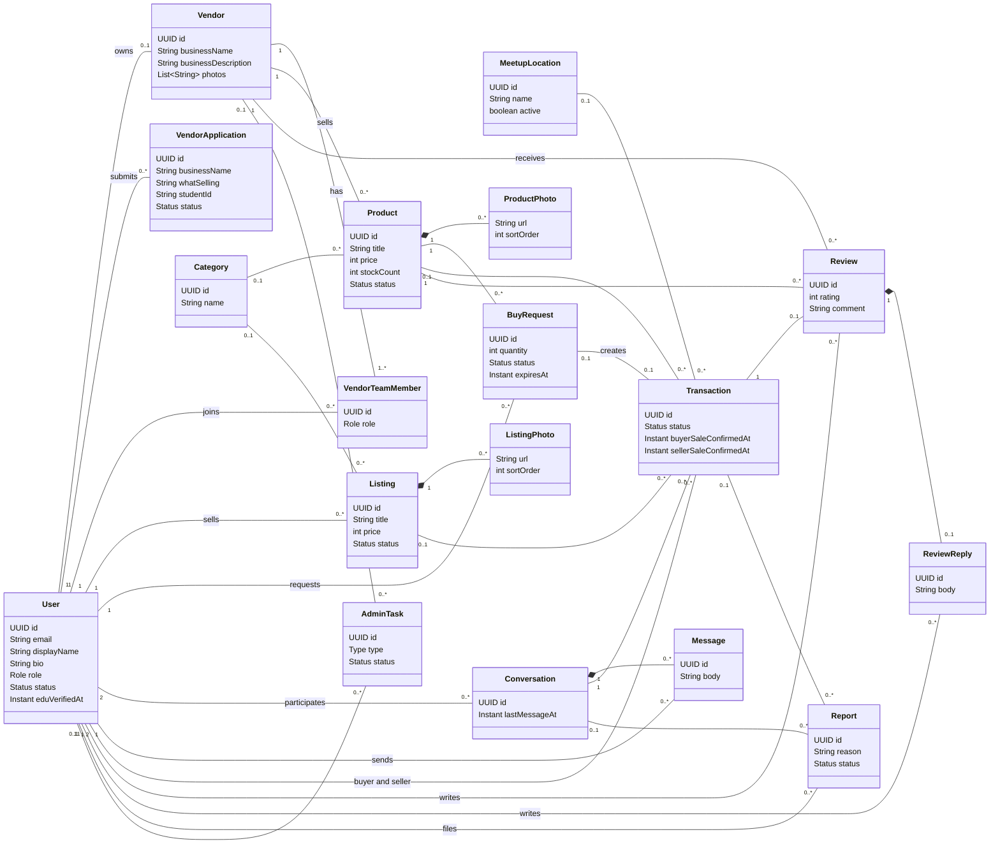

# Spartan Marketplace – Backend API

Spring Boot 3 + JPA + PostgreSQL REST API for the Spartan Marketplace (CSC 340 team project).

**Live URL:** https://spartan-marketplace-api.onrender.com

> **Cold start:** the free Render instance sleeps when idle, so the first request can take up to a minute. Wake it (e.g. `GET /api/categories`) before presenting.

## UML class diagram

Also saved at [`docs/UML-class-diagram.md`](../../docs/UML-class-diagram.md).



## Run locally

Requires JDK 21+. The database connection string comes from the environment only; never commit it.

```bash
export SPRING_DATASOURCE_URL="jdbc:postgresql://<neon-host>/<db>?user=<user>&password=<password>&sslmode=require"
export ADMIN_EMAILS="your.admin@campus.edu"   # these emails become SysAdmins on signup
./mvnw spring-boot:run
```

Tables are created automatically (`spring.jpa.hibernate.ddl-auto=update`). `./mvnw test` runs an end-to-end test against an embedded Postgres and needs no setup.

Deploy: `Dockerfile` (multi-stage JDK build, JRE run, `java -jar`). On Render use language **Docker**, Root Directory **backend/api**, and set `SPRING_DATASOURCE_URL` (plus `ADMIN_EMAILS`) to the main branch's Neon values.

## Conventions

- **IDs** are UUIDs. Related objects are linked by id in request bodies (`vendorId`, `buyerId`, `categoryId`, ...), never nested objects. Responses are DTOs, so there is no JSON recursion.
- **No login yet.** The caller identifies themselves by id: SysAdmin endpoints need an `X-Admin-Id` header (must be a user with role ADMIN), and actions by a user take `actorId` / `userId` / `buyerId` etc. in the body or query. Banned or restricted accounts get `403` on write actions; actions that require an authenticated user also need `.edu` verification.
- **SysAdmins:** an account whose email is listed in `ADMIN_EMAILS` becomes an ADMIN when it signs up.
- **Status codes:** create `201`, delete `204`, missing id `404`, invalid input `400`, wrong role or account standing `403`, rule violations (out of stock, duplicate, wrong state) `409`.
- **Prices** are integer cents. Provider = Vendor in the code (`/api/vendors`).

## Endpoints

Jonathan implemented the Provider (vendor) endpoints; Daryl implemented the Customer and SysAdmin endpoints and the shared entities.

| Story | Method | Path | Description | Success | Implemented by |
|---|---|---|---|---|---|
| US-1 | POST | `/api/users` | Create customer profile (.edu email required) | 201 | Daryl |
| US-1 | POST | `/api/users/{id}/verify-edu` | Complete .edu verification (stands in for emailed code) | 200 | Daryl |
| US-1 | GET | `/api/users/{id}` | View a profile | 200 | Daryl |
| US-1 | PUT | `/api/users/{id}` | Modify customer profile | 200 | Daryl |
| US-2/3 | GET | `/api/products` | Browse vendor products (`categoryId`, `minPrice`, `maxPrice`, `q`, `sort`, `vendorId`) | 200 | Daryl |
| US-2/3 | GET | `/api/products/{id}` | Product detail | 200 | Daryl |
| US-3 | GET | `/api/products/{id}/reviews` | Reviews on a product | 200 | Daryl |
| US-2/3 | GET | `/api/listings` | Browse live customer listings (same filters) | 200 | Daryl |
| US-3 | GET | `/api/listings/{id}` | Listing detail | 200 | Daryl |
| US-2 | GET | `/api/categories` | List categories | 200 | Daryl |
| US-8 | GET | `/api/meetup-locations` | List active meetup spots | 200 | Daryl |
| US-4 | POST | `/api/products/{id}/buy-requests` | Request to Buy; holds stock immediately | 201 | Daryl |
| US-4 | GET | `/api/users/{userId}/buy-requests` | A buyer's requests | 200 | Daryl |
| US-5 | POST | `/api/listings` | Create a listing (enters admin review) | 201 | Daryl |
| US-5 | PUT | `/api/listings/{id}` | Edit a listing (returns to review) | 200 | Daryl |
| US-5 | GET | `/api/users/{userId}/listings` | A seller's listings | 200 | Daryl |
| US-5 | DELETE | `/api/listings/{id}?userId=` | Delete a listing (seller or admin) | 204 | Daryl |
| US-6 | PUT | `/api/listings/{id}/sold?userId=` | Mark listing sold | 200 | Daryl |
| US-25 | POST | `/api/listings/{id}/transactions` | Buyer starts a purchase on a listing | 201 | Daryl |
| US-8 | POST | `/api/transactions/{id}/meetup` | Pick a meetup spot, or "Other" + liability acknowledgment | 200 | Daryl |
| US-25 | POST | `/api/transactions/{id}/confirm-intent` | Stage 1: confirm the meetup (each side) | 200 | Daryl |
| US-25 | POST | `/api/transactions/{id}/confirm-sale` | Stage 2: confirm the sale (each side); both = completed | 200 | Daryl |
| US-25 | POST | `/api/transactions/{id}/cancel` | Cancel; releases held vendor stock | 200 | Daryl |
| US-25 | GET | `/api/transactions/{id}?actorId=` | View a transaction | 200 | Daryl |
| US-25 | GET | `/api/users/{userId}/transactions` | A user's transactions | 200 | Daryl |
| US-7 | POST | `/api/transactions/{id}/reviews` | Review a completed vendor purchase | 201 | Daryl |
| US-27 | POST | `/api/conversations` | Open (or fetch) the 1:1 thread with another user | 201 | Daryl |
| US-27 | GET | `/api/users/{userId}/conversations` | A user's threads | 200 | Daryl |
| US-27 | GET | `/api/conversations/{id}/messages?userId=` | Read a thread | 200 | Daryl |
| US-27 | POST | `/api/conversations/{id}/messages` | Send a message | 201 | Daryl |
| US-9 | POST | `/api/reports` | Report a chat or transaction | 201 | Daryl |
| US-20 | POST | `/api/vendor-applications` | Apply to become a vendor | 201 | Jonathan |
| US-21 | GET | `/api/vendors` | List vendors | 200 | Jonathan |
| US-21 | GET | `/api/vendors/{id}` | Vendor profile | 200 | Jonathan |
| US-21 | PUT | `/api/vendors/{id}` | Modify vendor profile | 200 | Jonathan |
| US-22 | GET | `/api/vendors/{id}/team?actorId=` | List team members | 200 | Jonathan |
| US-22 | POST | `/api/vendors/{id}/team` | Add a team member (owner only) | 201 | Jonathan |
| US-22 | DELETE | `/api/vendors/{id}/team/{userId}?actorId=` | Remove a team member (owner only) | 204 | Jonathan |
| US-23 | POST | `/api/products` | Create a product | 201 | Jonathan |
| US-23 | PUT | `/api/products/{id}` | Modify a product / stock | 200 | Jonathan |
| US-24 | GET | `/api/vendors/{id}/buy-requests?actorId=` | Vendor's incoming requests | 200 | Jonathan |
| US-24 | PUT | `/api/buy-requests/{id}/accept` | Accept; opens messaging + a transaction | 200 | Jonathan |
| US-24 | PUT | `/api/buy-requests/{id}/reject` | Reject; releases held stock | 200 | Jonathan |
| US-26 | GET | `/api/vendors/{id}/statistics?actorId=` | Customer analytics: transactions, feedback, report history | 200 | Jonathan |
| US-26 | GET | `/api/vendors/{id}/reviews` | Reviews received | 200 | Jonathan |
| US-26 | POST | `/api/reviews/{id}/replies` | Reply under a review | 201 | Jonathan |
| US-31 | GET | `/api/users` | List users (`status` filter) | 200 | Daryl |
| US-31 | PUT | `/api/users/{id}/status` | Restrict / ban / reactivate an account | 200 | Daryl |
| US-30 | GET | `/api/vendor-applications` | Pending vendor applications (`status` filter) | 200 | Daryl |
| US-30 | PUT | `/api/vendor-applications/{id}/approve` | Approve: applicant becomes a vendor | 200 | Daryl |
| US-30 | PUT | `/api/vendor-applications/{id}/reject` | Reject an application | 200 | Daryl |
| US-32 | GET | `/api/listings/pending` | Listing review queue | 200 | Daryl |
| US-32 | PUT | `/api/listings/{id}/approve` | Approve a listing (goes live) | 200 | Daryl |
| US-32 | PUT | `/api/listings/{id}/reject` | Reject a listing | 200 | Daryl |
| US-33 | PUT | `/api/vendors/{id}/hide` | Hide all of a vendor's products | 200 | Daryl |
| US-33 | PUT | `/api/vendors/{id}/unhide` | Restore a vendor's products | 200 | Daryl |
| US-33 | DELETE | `/api/products/{id}` | Remove a product | 204 | Daryl |
| US-34 | GET | `/api/reports` | Report queue (`status` filter) | 200 | Daryl |
| US-34 | PUT | `/api/reports/{id}` | Set report status | 200 | Daryl |
| US-34 | GET | `/api/users/{userId}/reports` | Full report history for a user | 200 | Daryl |
| US-34 | GET | `/api/reviews` | All reviews | 200 | Daryl |
| US-34 | DELETE | `/api/reviews/{id}` | Remove a review | 204 | Daryl |
| US-35/36 | GET | `/api/admin-tasks` | Auto-flags: review-bombing, serial bad reviewer | 200 | Daryl |
| US-35/36 | PUT | `/api/admin-tasks/{id}/resolve` | Resolve a flag | 200 | Daryl |
| US-37 | GET | `/api/statistics` | Platform usage statistics | 200 | Daryl |
| Admin | POST/PUT/DELETE | `/api/categories[/{id}]` | Manage categories | 201 / 200 / 204 | Daryl |
| Admin | POST/PUT/DELETE | `/api/meetup-locations[/{id}]` | Manage meetup spots | 201 / 200 / 204 | Daryl |

## Example request bodies

Create customer (`POST /api/users`) / modify (`PUT /api/users/{id}`):
```json
{ "email": "alice@campus.edu", "displayName": "Alice", "bio": "CS junior" }
```
Set account status (`PUT /api/users/{id}/status`, header `X-Admin-Id`):
```json
{ "status": "BANNED" }
```
Vendor application (`POST /api/vendor-applications`):
```json
{ "userId": "<user id>", "businessName": "Cookie Co", "businessDescription": "Fresh baked", "whatSelling": "Cookies",
  "licensesHeld": "Food handler", "desiredSellingLocation": "Student Union", "teamSize": 2, "studentId": "900123456" }
```
Modify vendor (`PUT /api/vendors/{id}`):
```json
{ "actorId": "<team member id>", "businessName": "Cookie Co", "businessDescription": "Now with brownies", "photos": ["https://example.com/a.png"] }
```
Add team member (`POST /api/vendors/{id}/team`):
```json
{ "actorId": "<owner id>", "userId": "<user id>" }
```
Create / modify product (`POST /api/products`, `PUT /api/products/{id}`; `vendorId` is used on create only):
```json
{ "actorId": "<team member id>", "vendorId": "<vendor id>", "title": "Chocolate chip cookie", "description": "Warm", "price": 300,
  "stockCount": 20, "categoryId": "<category id>", "photoUrls": ["https://example.com/cookie.png"] }
```
Request to Buy (`POST /api/products/{id}/buy-requests`):
```json
{ "buyerId": "<user id>", "quantity": 2 }
```
Accept / reject (`PUT /api/buy-requests/{id}/accept|reject`), also `confirm-intent`, `confirm-sale`, `cancel`:
```json
{ "actorId": "<vendor team member or buyer id>" }
```
Create / modify listing (`POST /api/listings`, `PUT /api/listings/{id}`):
```json
{ "sellerId": "<user id>", "title": "Calculus textbook", "description": "Like new", "price": 2500, "categoryId": "<category id>",
  "photoUrls": ["https://example.com/book.png"] }
```
Start listing purchase (`POST /api/listings/{id}/transactions`):
```json
{ "buyerId": "<user id>" }
```
Choose meetup (`POST /api/transactions/{id}/meetup`) – a spot, or `"Other"` (null id) with the acknowledgment:
```json
{ "actorId": "<buyer or seller id>", "meetupLocationId": "<meetup id>" }
{ "actorId": "<buyer or seller id>", "meetupLocationId": null, "liabilityAcknowledged": true }
```
Review (`POST /api/transactions/{id}/reviews`, buyer of a completed vendor sale):
```json
{ "reviewerId": "<buyer id>", "rating": 5, "comment": "Great cookies" }
```
Reply (`POST /api/reviews/{id}/replies`):
```json
{ "authorId": "<vendor team member id>", "body": "Thanks for the feedback!" }
```
Open conversation (`POST /api/conversations`) and send message (`POST /api/conversations/{id}/messages`):
```json
{ "userId": "<user id>", "otherUserId": "<other user id>" }
{ "senderId": "<user id>", "body": "See you at 3pm" }
```
Report (`POST /api/reports`, at least one of `transactionId` / `conversationId`):
```json
{ "reporterId": "<user id>", "conversationId": "<conversation id>", "reason": "Suspicious messages" }
```
Report status (`PUT /api/reports/{id}`, statuses `PENDING`, `REVIEWED`, `DISMISSED`, `ACTIONED`):
```json
{ "status": "ACTIONED" }
```
Category (`POST/PUT /api/categories`) and meetup spot (`POST/PUT /api/meetup-locations`), header `X-Admin-Id`:
```json
{ "name": "Food" }
{ "name": "Student Union", "description": "Main lobby", "active": true }
```

## Business rules worth knowing

- Request to Buy decrements stock atomically; reject, cancel, or a 24h timeout puts it back.
- Reviews unlock only when both sides confirm the sale; one review per transaction; customer listings are not reviewable.
- More than 10 bad reviews (rating 1-2) on a vendor in 24h, or more than 3 from one reviewer in 7 days, creates an admin task.
- Editing a live listing sends it back to the review queue.
